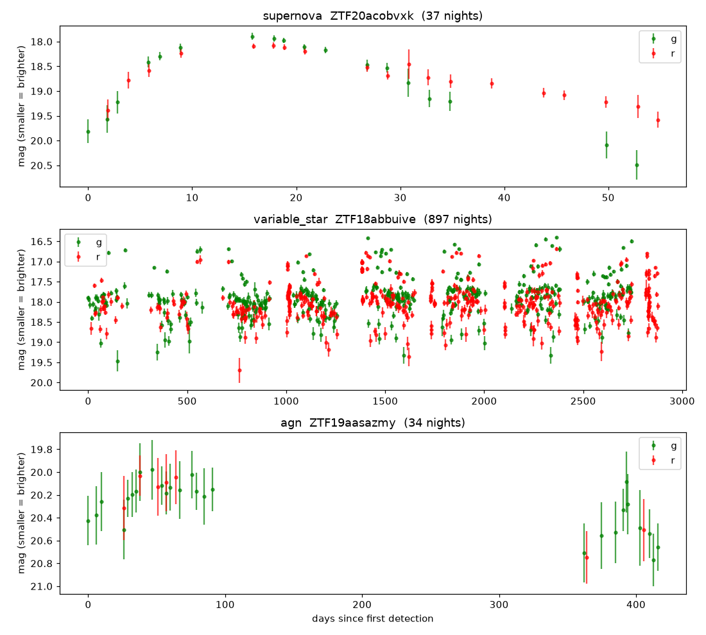
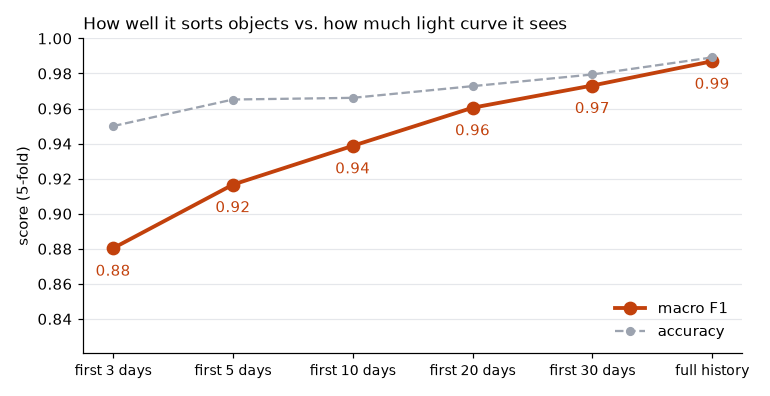

# early-supernova-classifier

Sorts new sky alerts from the Zwicky Transient Facility (ZTF) into supernova, variable star, or active galaxy, using only how the object's brightness changes over time.



*A supernova rises fast and fades over weeks. A variable star flickers for years. An active galaxy wanders slowly. Green and red are the two colour filters.*

## Why early matters

A supernova is brightest for only a few weeks, and the most useful measurements (a spectrum, follow-up images) have to be taken near the start. ZTF flags thousands of changing objects every night, and most are not supernovae. Picking the real ones out within days tells astronomers where to point a larger telescope while there is still something to see.

## How it works

1. `fetch.py` downloads labelled objects and their brightness measurements from the free [ALeRCE](https://alerce.online) service, which republishes ZTF alerts.
2. `train.py` turns each light curve into 47 numbers (rise time, fade speed, colour, whether it sits on a known star, and so on) and trains a random forest.
3. To test early classification, every light curve is cut to its first N days before the numbers are computed.
4. `tonight.py` scores objects first seen in the last few days and lists the most likely supernovae with links.

## Results

Scored with 5-fold cross-validation on 1,939 objects. Macro F1 is the average of the per-class F1 scores, so the small active-galaxy class counts as much as the large supernova class.



| light curve used | objects scored | accuracy | macro F1 |
|---|---|---|---|
| first 10 days | 1,210 | 0.97 | 0.94 |
| first 30 days | 1,751 | 0.98 | 0.97 |
| full history  | 1,939 | 0.99 | 0.99 |

Full history is easy: supernovae last weeks and variable stars are watched for years, so length alone separates them. The early rows are the real test. At 10 days the weak spot is active galaxies: 81% are caught, the rest are mistaken for supernovae or variable stars.

## Run it

Needs [uv](https://docs.astral.sh/uv/) and Python 3.13.

```sh
uv sync
uv run pytest -q                   # feature checks, no network
uv run python fetch.py 200         # up to 200 objects per sub-class -> data/ (takes a while)
uv run python train.py 10          # report using the first 10 days; omit the number for full history
uv run python chart.py             # redraws docs/accuracy.png
uv run python tonight.py 10 20     # top 20 candidates first seen in the last 10 days
uv run python viz.py               # pictures of those candidates -> data/tonight.png
```

Downloaded data goes in `data/` and is not part of the repo.

## Known limits

- The labels come from ALeRCE's own classifier at high confidence, not from spectra. The model learns to agree with ALeRCE, and the high-confidence objects are the easy ones. Real ground truth would come from the ZTF Bright Transient Survey list (swap out `fetch_labels` in `fetch.py`).
- Objects with fewer than 3 measurements in a filter within the window are dropped, so the 10-day test covers 1,210 of 1,939 objects. Very young objects are not tested.
- The numbers shift slightly with each fresh download, because ALeRCE's object lists change over time.

## Licence

MIT, see [LICENSE](LICENSE).
